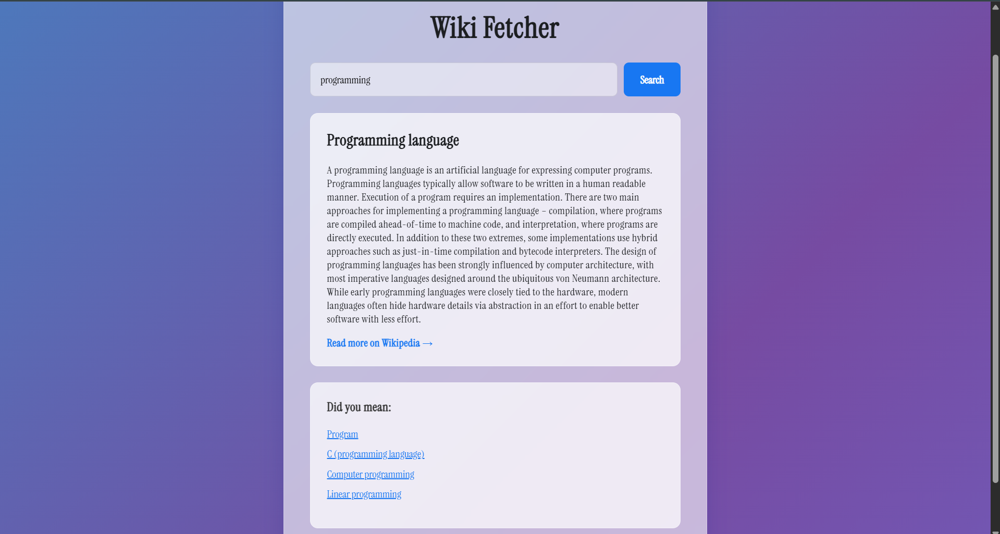

# Wikipedia Search & Topic Explorer

A Spring Boot web application that searches Wikipedia, displays article summaries, and helps users explore related topics. MongoDB is used to cache article results and retain recent search history.




## Features

- Search Wikipedia through a browser-based interface.
- Display an article title, summary, and link to the source article.
- Show related topics and suggestions for further exploration.
- Cache article data in MongoDB to avoid repeating some lookups.
- Keep recent search history.
- Use fuzzy title matching to help resolve approximate queries.

## How it works

```text
Browser (Thymeleaf page)
        ↓
SearchController
        ↓
WikipediaService
   ┌────┼─────────────┐
   ↓    ↓             ↓
MongoDB  OpenSearch   Wikipedia API
cache   resolution   fallback/retrieval
   └────┴─────────────┘
        ↓
Article result + related topics
        ↓
Thymeleaf renders the response
```

The quick summary is derived from article text (for example, its first few sentences); it is not generated by an AI model.

## Technology

- Java 17
- Spring Boot 3.5.x
- Spring Web / REST support
- Thymeleaf
- Spring Data MongoDB
- MongoDB
- Apache Commons Text for fuzzy matching
- HTML, CSS, JavaScript

## Requirements

- Java 17 or newer compatible with the project
- Maven
- A reachable MongoDB instance
- Internet access for Wikipedia API requests and OpenSearch resolution

## Configuration

The application is configured to use a local MongoDB database named `wikifetcher` in the reviewed code. Check `src/main/resources/application.properties` before running and adjust the URI/database configuration for your environment.

Article cache entries are configured with a 24-hour TTL. Search history is also stored in MongoDB.

## Run locally

From the backend project directory (the directory containing `pom.xml`):

```bash
mvn spring-boot:run
```

Alternatively, use the repository's Maven wrapper if one is included. Open the application at the configured Spring Boot port, which defaults to `http://localhost:8080` unless changed in configuration.

## Main flow

1. A user submits a query through the search page.
2. The controller validates the query and invokes the service.
3. The service checks cached data and attempts to resolve the topic.
4. If needed, it requests article data from Wikipedia.
5. The service assembles an article result and related-topic suggestions.
6. The page displays the result and updates recent search history.

## Notes and limitations

- Results depend on Wikipedia and the external lookup service being available.
- Fuzzy matching helps with approximate titles; it does not guarantee that every ambiguous query resolves to the intended article.
- The project includes a basic Spring Boot context-load test. It should not be described as having comprehensive automated test coverage.
- The tech-oriented query handling is heuristic and may resolve some general terms to non-technical pages.
